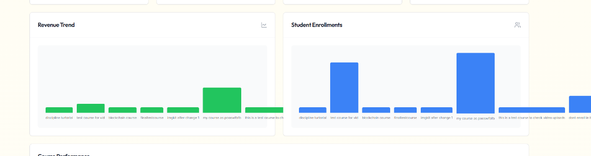
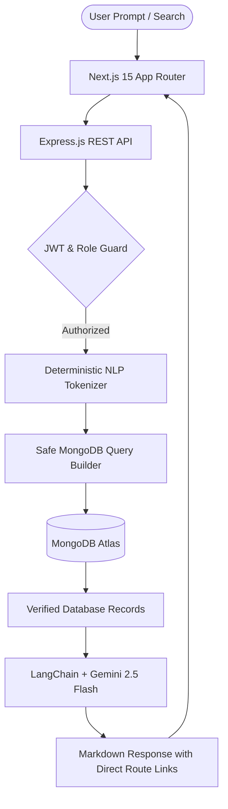

<div align="center">


# Gurukul - Create what you love, and start earning

**A full-stack, open-source educational platform uniting video learning, community discussions, creator monetization, and grounded AI assistance.**

[](https://nextjs.org/)
[](https://react.dev/)
[](https://nodejs.org/)
[](https://expressjs.com/)
[](https://www.mongodb.com/)
[](https://ai.google.dev/)
[](https://tailwindcss.com/)
[](https://opensource.org/licenses/MIT)

<br />


</div>

---

## Overview

Gurukul is an open-source educational suite built to provide an end-to-end learning and course-authoring ecosystem. It connects content creators and students through curated video courses, interactive community groups, scheduled live events, and a grounded AI learning companion.

The platform is designed with three core architectural objectives:

1. **Zero-Hallucination AI Support**: An on-platform assistant utilizing a deterministic query-generation pipeline with Google Gemini 2.5 Flash, providing verified platform responses and direct Markdown deep-links.
2. **Server-Side Debounced Discovery**: High-efficiency search and filtering executed on indexed MongoDB collections with 300ms debouncing, minimizing server load while delivering responsive catalog browsing.
3. **Turnkey Creator Studio**: Streamlined video uploading, modular curriculum creation, course pricing in USD, and clean visual analytics for enrollments and revenue.

---

## Core Highlights

- 🎓 **Structured Video Curriculums** — Modular lessons, integrated video playback, resume-from-last-point progress tracking, and public preview lectures.
- 👥 **Interactive Community Spaces** — Dedicated discussion groups, image-supported forum posts, and event scheduling with RSVP functionality.
- 🤖 **Context-Aware AI Assistant** — Natural language search for courses, communities, and upcoming events with role-enforced access controls.
- 📊 **Creator Analytics & Insights** — Lightweight visual charts tracking course enrollments, active student metrics, and cumulative revenue.
- 🔐 **Hardened Role-Based Auth** — Granular permissions across `guest`, `student`, `creator`, and `admin` roles, backed by bcrypt password hashing and JSON Web Tokens.
- ⚡ **Modern Responsive Interface** — Built using Next.js 15 App Router, React 19, and Tailwind CSS with clean, borderless icons and mobile-first ergonomics.

---

## Platform Showcase

| Course Experience | Creator Analytics |
|:---:|:---:|
|  |  |
| **Immersive Course Catalog & Lessons**<br />Detailed curriculums, ratings, previews, and enrollment actions. | **Creator Studio & Performance Metrics**<br />Visual analytics on monthly revenue and student participation. |
|  |  |
| **Community Discussion Hub**<br />Topic-based discussions, media uploads, and scheduled events. | **Full-Spectrum Technical Curriculums**<br />Rich metadata, category filters, and cross-discipline learning. |

---

## Architecture & AI Retrieval Pipeline

Gurukul combines traditional relational data querying with generative AI synthesis to ensure platform data remains accurate and grounded.



- **Query Tokenization**: Incoming queries are analyzed to detect intent (courses, communities, events, profile) and extract relevant keywords.
- **Data Grounding**: Queries run directly against MongoDB Atlas, scoping retrieval to the user's role permissions.
- **Synthesis**: The Gemini model receives the verified context to construct a clear, friendly summary containing clickable application paths.

---

## Directory Structure

```text
gurukul-platform/
├── backend/                       # Node.js & Express REST Backend
│   ├── config/                    # Database (Mongoose) & ImageKit settings
│   ├── controllers/               # Route handlers (auth, course, community, chat)
│   ├── middleware/                # JWT verification & role authorization guards
│   ├── models/                    # MongoDB schemas (User, Course, Community, Post)
│   ├── routes/                    # API route definitions
│   ├── scripts/                   # Database seed scripts (seed.js)
│   ├── services/                  # Business logic & AI pipeline (chatNLP.service.js)
│   └── server.js                  # Backend application entry point
│
├── frontend-next/                 # Next.js 15 App Router Frontend
│   ├── app/                       # Page routes & layouts
│   ├── assets/                    # Platform logos and branding assets
│   ├── components/                # Modular UI components (Navbar, ChatAssistant, Cards)
│   ├── contexts/                  # React context providers (AuthContext)
│   ├── hooks/                     # Custom React hooks (debouncing, analytics)
│   ├── public/                    # Static images, icons, and banners
│   └── tailwind.config.js         # Tailwind CSS design system configuration
│
├── docs/                          # Project documentation and screenshots
│   └── assets/                    # Showcase graphics and diagram assets
└── README.md                      # Repository documentation
```

---

## Role-Based Access Control (RBAC)

| Feature / Resource | Guest | Student | Creator | Admin |
|:---|:---:|:---:|:---:|:---:|
| **Browse Courses & Communities** | ✅ | ✅ | ✅ | ✅ |
| **Search & Debounced Filters** | ✅ | ✅ | ✅ | ✅ |
| **Enroll in Courses** | ❌ | ✅ | ✅ | ✅ |
| **Post in Communities & RSVP** | ❌ | ✅ | ✅ | ✅ |
| **Create & Publish Courses** | ❌ | ❌ | ✅ | ✅ |
| **Upload Course Videos** | ❌ | ❌ | ✅ | ✅ |
| **Access Creator Analytics** | ❌ | ❌ | ✅ | ✅ |
| **AI Learning Assistant** | ✅ *(General)* | ✅ *(Enrolled)* | ✅ *(Teaching)* | ✅ *(Full)* |

---

## Quick Start Guide

### Prerequisites
- **Node.js**: v18.0.0 or later
- **npm**: v9.0.0 or later
- **MongoDB**: Local MongoDB instance or free MongoDB Atlas cluster

---

### 1. Repository Setup

```bash
git clone https://github.com/PRAVESH-110/Gurukul-V2.git
cd Gurukul-V2
```

---

### 2. Backend Setup

Navigate to the `backend` directory and install dependencies:

```bash
cd backend
npm install
```

Configure your environment variables by creating a `.env` file:

```env
PORT=5001
NODE_ENV=development
MONGODB_URI=your_mongodb_connection_string
JWT_SECRET=your_jwt_secret_key
CLIENT_URL=http://localhost:3000

# Optional Services
GEMINI_API_KEY=your_gemini_api_key
IMAGEKIT_PUBLIC_KEY=your_imagekit_public_key
IMAGEKIT_PRIVATE_KEY=your_imagekit_private_key
IMAGEKIT_URL_ENDPOINT=your_imagekit_endpoint
```

Populate the database with sample courses, instructors, and communities:

```bash
npm run seed
```

Start the backend server:

```bash
npm run dev
```

The API will be available at `http://localhost:5001`.

---

### 3. Frontend Setup

In a new terminal, navigate to the `frontend-next` directory and install dependencies:

```bash
cd frontend-next
npm install
```

Create a `.env.local` file in the `frontend-next` folder:

```env
NEXT_PUBLIC_API_URL=http://localhost:5001/api
```

Start the development server:

```bash
npm run dev
```

Open `http://localhost:3000` in your browser.

---

### Pre-Configured Test Accounts

The included seeder (`npm run seed`) provisions the following ready-to-use testing accounts:

| Role | Email Address | Password | Intended Test Flows |
|:---|:---|:---|:---|
| **Student** | `student@gurukul.com` | `password123` | Browsing, enrollment, video progress, community participation |
| **Creator** | `creator@gurukul.com` | `password123` | Course creation, curriculum management, revenue analytics |
| **Admin** | `admin@gurukul.com` | `password123` | Platform oversight, administrative permissions |

---

## Key API Endpoints

### Authentication
- `POST /api/auth/register` — Register a new account (`student` or `creator`)
- `POST /api/auth/login` — Authenticate and receive a JWT token
- `GET  /api/auth/me` — Retrieve the authenticated profile
- `POST /api/auth/logout` — Invalidate the session

### Courses
- `GET  /api/courses` — Paginated course catalog with server-side query & category filters
- `POST /api/courses` — Create a new course *(Creator / Admin)*
- `GET  /api/courses/:id` — Course curriculum and lecture details
- `POST /api/courses/:id/enroll` — Enroll current student in a course

### Communities & Events
- `GET  /api/communities` — List active communities
- `POST /api/communities` — Create a new community space *(Creator / Admin)*
- `GET  /api/communities/:id/posts` — Retrieve community discussions
- `POST /api/communities/:id/posts` — Publish a forum post
- `POST /api/communities/:id/events/:eventId/rsvp` — RSVP for a community event

### Grounded AI Assistant
- `POST /api/chat` — Submit a natural language prompt for role-filtered, grounded answers

---

## Contributing

Contributions are welcome! Please follow these steps to propose improvements:

1. Fork the repository.
2. Create a feature branch: `git checkout -b feature/your-feature-name`.
3. Commit your changes: `git commit -m "feat: describe your change"`.
4. Push to your branch: `git push origin feature/your-feature-name`.
5. Open a Pull Request detailing your enhancements and test coverage.

---

## License

This project is licensed under the [MIT License](https://opensource.org/licenses/MIT).
